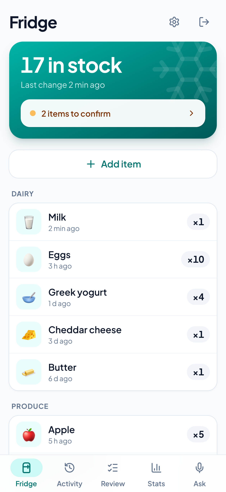
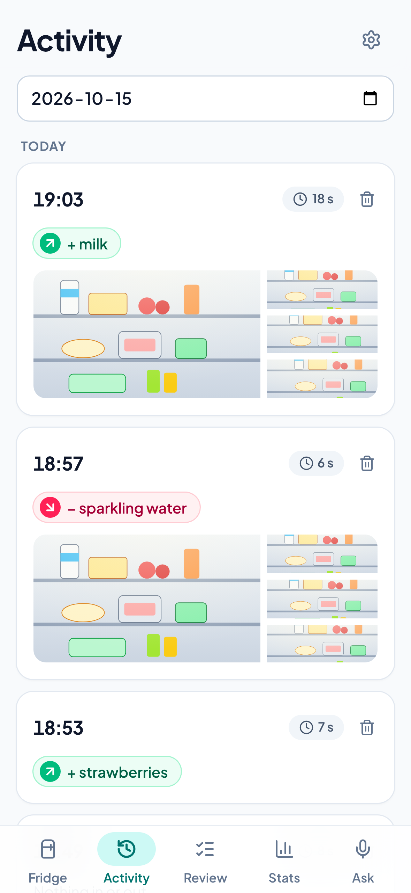
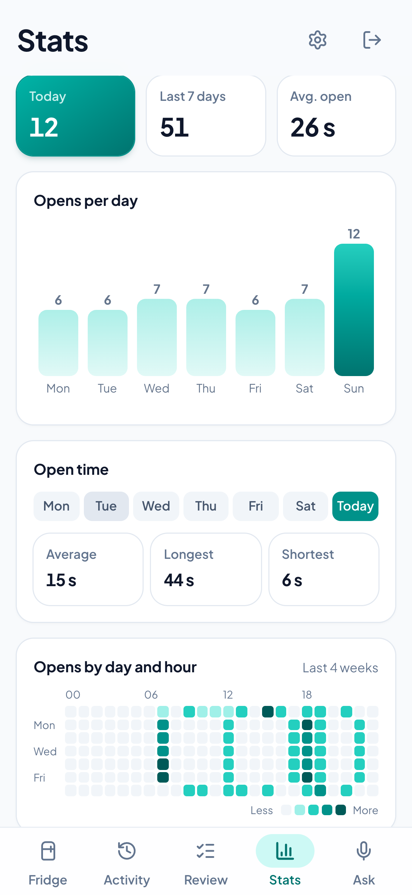
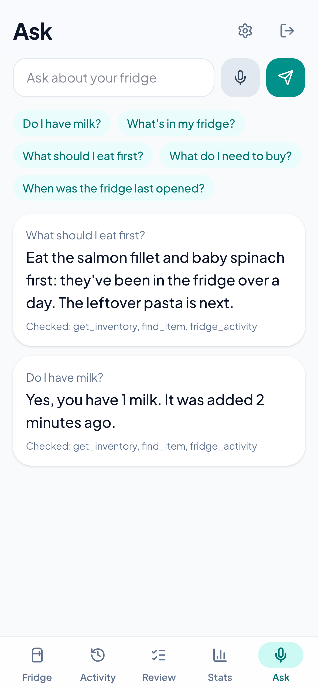
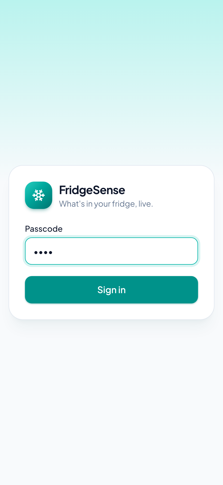
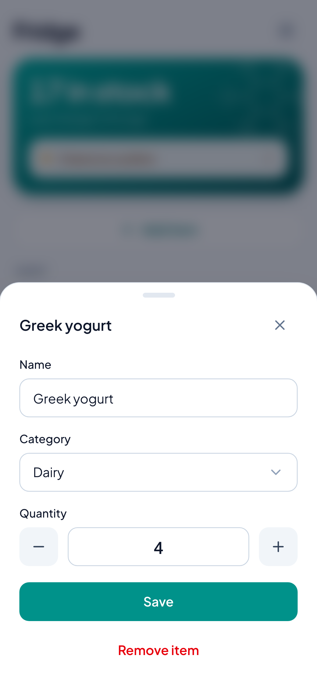
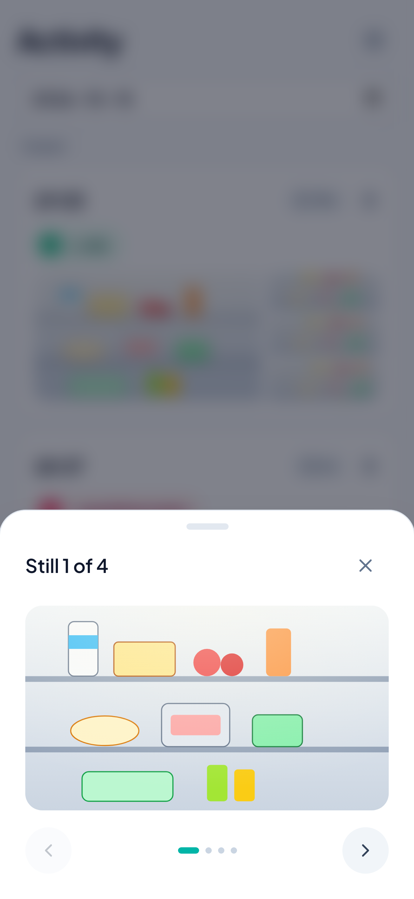
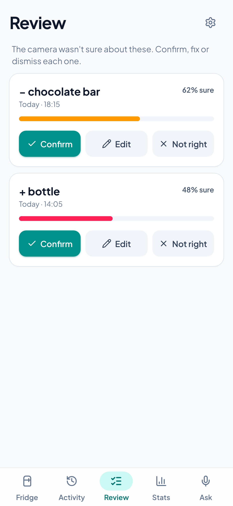
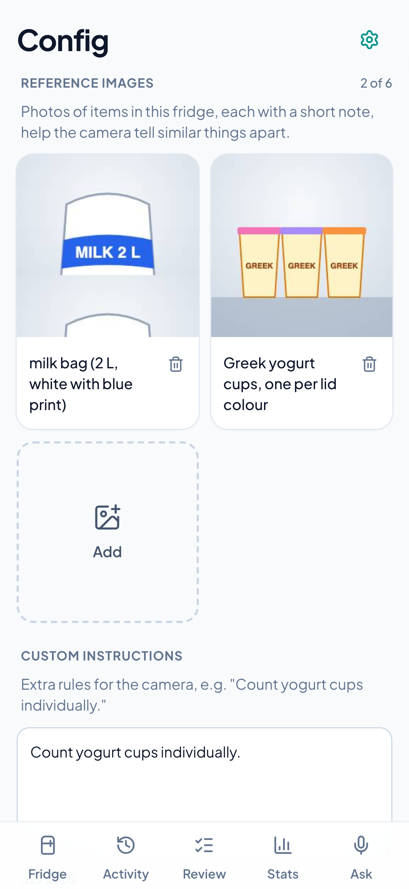

# FridgeSense

A Ring Indoor Cam 2K watches your fridge. Each time the door opens, the clip goes to S3 and Amazon Bedrock Nova lists what went in or came out. FridgeSense keeps a running inventory and door open/close statistics, available in a PWA and through an MCP server for Alexa+.

See [docs/hackathon-plan.md](docs/hackathon-plan.md) for the full plan.

<table>
  <tr>
    <td align="center"><picture><source media="(prefers-color-scheme: dark)" srcset="docs/screenshots/dark/01-fridge.png"></picture><br><b>Fridge</b></td>
    <td align="center"><picture><source media="(prefers-color-scheme: dark)" srcset="docs/screenshots/dark/03-activity.png"></picture><br><b>Activity</b></td>
    <td align="center"><picture><source media="(prefers-color-scheme: dark)" srcset="docs/screenshots/dark/06-stats.png"></picture><br><b>Stats</b></td>
    <td align="center"><picture><source media="(prefers-color-scheme: dark)" srcset="docs/screenshots/dark/07-ask.png"></picture><br><b>Ask</b></td>
  </tr>
</table>

<details>
<summary>More screens</summary>
<br>
<table>
  <tr>
    <td align="center"><picture><source media="(prefers-color-scheme: dark)" srcset="docs/screenshots/dark/00-sign-in.png"></picture><br><b>Sign in</b></td>
    <td align="center"><picture><source media="(prefers-color-scheme: dark)" srcset="docs/screenshots/dark/02-fridge-edit-item.png"></picture><br><b>Edit an item</b></td>
    <td align="center"><picture><source media="(prefers-color-scheme: dark)" srcset="docs/screenshots/dark/04-activity-still-viewer.png"></picture><br><b>Camera stills</b></td>
  </tr>
  <tr>
    <td align="center"><picture><source media="(prefers-color-scheme: dark)" srcset="docs/screenshots/dark/05-review.png"></picture><br><b>Review</b></td>
    <td align="center"><picture><source media="(prefers-color-scheme: dark)" srcset="docs/screenshots/dark/08-config.png"></picture><br><b>Config</b></td>
    <td></td>
  </tr>
</table>
</details>

<sub>Screenshots use made-up data from the local mock (`FRIDGESENSE_MOCK=1`); they follow your light or dark theme.</sub>

## Try it (judges)

> **TODO before submitting:** replace the two placeholders below after `cdk deploy` and after setting the demo passcode (see [Demo access](#demo-access)).

- App: **`<SiteUrl>`** (open it on a phone and add it to the home screen)
- Demo passcode: **`<demo passcode>`**

The demo passcode signs in **read-only** to the live fridge: the current inventory, door openings day by day (stills for the last 7 days), items waiting for confirmation, and open/close stats. A "Demo · read-only" badge shows on every screen; confirming, editing and fixing counts are disabled.

## Development

The project is spec-driven with [OpenSpec](https://github.com/Fission-AI/OpenSpec) and built test-first. See [CLAUDE.md](CLAUDE.md) for the workflow.

### Layout

- `backend/`: Python 3.13 package `fridgesense` (Ring client, Lambda handlers, CLI). uv + pytest.
- `infra/`: AWS CDK app in TypeScript. Vitest.
- `pwa/`: the phone app (Vite, React, Tailwind, Recharts, vite-plugin-pwa). Vitest + Testing Library.
- `openspec/`: specs and changes.

### Run the tests

Prerequisites: [uv](https://docs.astral.sh/uv/) and Node.js 22.

```bash
cd backend && uv sync && uv run pytest && uv run ruff check
```

```bash
cd infra && npm ci && npm test
```

```bash
cd pwa && npm ci && npm test
```

Tests never call Ring or AWS: Ring responses come from `backend/tests/fixtures/`, AWS is mocked with moto.

## Setup: deploy and link a Ring camera

You need an AWS account (us-east-1), a Ring account with a camera and a Ring plan or trial, and a `.env` file at the repo root with `AWS_PROFILE=<your profile>`. Every AWS command below loads that profile first.

### 1. Deploy

The first deploy in an account needs a one-time CDK bootstrap:

```bash
set -a; source .env; set +a; cd infra && npm ci && npx cdk bootstrap -c alertEmail=you@example.com
```

Then deploy. Lambda packages are built locally with uv (no Docker):

```bash
set -a; source .env; set +a; cd infra && npx cdk deploy -c alertEmail=you@example.com
```

Every `cdk` command (`synth`, `diff`, `deploy`) needs `-c alertEmail=<address>`: it receives the $20/month budget alert (at 80%) and the alarm for failed door-event runs. To skip typing it, put `{"alertEmail": "<address>"}` in `infra/cdk.context.json`, which git ignores. After the first deploy, confirm the SNS subscription from the email AWS sends, or the alarm emails nothing.

The API is throttled at 10 requests/s (burst 20) per route, and the two passcode checks (`POST /api/session`, `POST /ring/link`) at 1 request/s (burst 3).

The outputs list three URLs: `TokenExchangeUrl`, `AccountLinkUrl` and `WebhookUrl`.

### 2. Create the Ring private app

1. Register at the [Ring developer console](https://developer.amazon.com/ring/console) and create a **Private** app with the Cameras and Doorbells scope.
2. On the app's **Account linking** page, paste `AccountLinkUrl`, `TokenExchangeUrl` and `WebhookUrl` from the deploy outputs into the matching fields, and `SiteUrl` (the app) into **App Homepage URL**.
3. Copy the **Client ID**, **Client Secret** and **webhook signing (HMAC) key**. Ring shows them only once.

### 3. Store the Ring credentials

The deploy created the secret `fridgesense/ring-app` with a random link passcode. Add the three Ring values to it. The values are read without echoing, so they stay out of your shell history:

```bash
set -a; source .env; set +a; read -rs "RING_CLIENT_ID?Client ID: "; echo; read -rs "RING_CLIENT_SECRET?Client Secret: "; echo; read -rs "RING_HMAC_KEY?HMAC key: "; echo; aws secretsmanager get-secret-value --secret-id fridgesense/ring-app --query SecretString --output text | jq --arg id "$RING_CLIENT_ID" --arg secret "$RING_CLIENT_SECRET" --arg key "$RING_HMAC_KEY" '.client_id=$id | .client_secret=$secret | .hmac_key=$key' | aws secretsmanager put-secret-value --secret-id fridgesense/ring-app --secret-string file:///dev/stdin
```

(`read -rs "VAR?prompt"` is zsh syntax; in bash use `read -rsp "prompt" VAR`.)

Show the link passcode, which you type on the link page in the next step:

```bash
set -a; source .env; set +a; aws secretsmanager get-secret-value --secret-id fridgesense/ring-app --query SecretString --output text | jq -r .passcode
```

### 4. Link the account

Install the app from the Ring app or console. Ring exchanges tokens with FridgeSense in the background, then opens the link page in your browser. Enter the passcode and the page confirms the link and lists your cameras.

Check the link and list the cameras at any time:

```bash
set -a; source .env; set +a; cd backend && uv run fridgesense-devices
```

Ring tokens are refreshed every 3 hours. If a refresh is ever rejected, the logs show `token_refresh_rejected`; link again from the Ring app.

### 5. What happens on a door opening

1. Ring sends a motion webhook. FridgeSense starts one Step Functions run (`fridgesense-door-events`) for it.
2. The run waits for Ring to finish the recording, then finds the event's start and end in Ring's history.
3. It downloads the recording once from Ring and checks a frame every 0.5 s in the door zones, however long the motion lasted. The first open frame and the first closed frame after it give the door event's `opened_at` and `closed_at`, so `duration_s` is how long the door was really open, not how long someone stood in view. Motion without an opening stops here, so no face detection or Nova call is made. The clip stays in the Lambda's `/tmp` and is never stored. If Ring has no clip for the motion, the step logs `clip_unavailable` with the reason and checks about one still per second instead (4 to 30 of them).
4. Up to 4 stills from the open stretch go on: Ring stills at the picked times, which are sharper than video frames (the clip frame stands in if a still can't be downloaded). Each is cropped to the strip the camera's privacy mask leaves visible. Amazon Rekognition finds any faces and each one is blurred before the still is stored in S3, so no unblurred face reaches S3, the app or Nova. If face detection fails, that still is dropped rather than stored. The stills are deleted after 7 days.
5. Amazon Nova 2 Lite compares the stills and lists items added and removed. Changes with confidence 0.7 or more update the inventory; the rest wait for confirmation.

Nova 2 Lite runs through the `us.` cross-region inference profile, so a still may be processed in us-east-1, us-east-2 or us-west-2. To use Nova Lite v1 in us-east-1 only, deploy with `-c novaModelId=amazon.nova-lite-v1:0 -c novaPriceIn=0.00006 -c novaPriceOut=0.00024`.

### 6. Set up the door check

Teach FridgeSense what your fridge looks like open and closed, from the app: **Config → Open/close detection**.

1. Tap **Add**. The app takes a snapshot from the camera (faces blurred). If it says there is no recent footage, walk past the camera and try again: the camera only records when something moves.
2. Drag a box around one door or drawer, mark the snapshot **Open** or **Closed**, and save.
3. Add each door and drawer both ways, ideally in daylight and with the kitchen lights on, and once with someone standing in front of the closed fridge.
4. Tap **Run setup**. For each box, setup measures three signals on your references: **Color** (the lit interior and food are colourful, steel is grey), **Brightness** and **Change** (how different it looks from your closed snapshots). It keeps the one that best separates open from closed and puts the threshold halfway between them. Each zone shows its rule and margin; a bigger margin is safer.

If setup reports that open and closed overlap, a reference is probably mislabeled or its box misses the door. Delete it and add a new one. After adding or deleting references, run setup again.

Until setup has run, the check uses colourful pixels in the `doorZones` from CDK context (fractions `x,y,width,height` of the camera frame, separated by `;`) with `doorThreshold` 0.02. To see the scores of motion the pipeline rejected:

```bash
set -a; source .env; set +a; aws logs tail /fridgesense/pipeline --since 1h --filter-pattern '"motion_not_door"'
```

Each line shows `score`, the `zone` and `feature` that scored it, `threshold`, and `zones_source` (`setup` or `default`). `stillCrop` is the visible strip kept for storage and Nova (`-c stillCrop=` keeps the full frame), `doorFrameIntervalMs` sets the time between checked clip frames (default 500), and `stillIntervalMs` the time between stills when there is no clip:

```bash
set -a; source .env; set +a; cd infra && npx cdk deploy -c alertEmail=you@example.com -c "doorZones=0.38,0.32,0.21,0.30;0.455,0.60,0.12,0.18" -c doorThreshold=0.02 -c stillCrop=0.30,0.0,0.34,1.0 -c doorFrameIntervalMs=500 -c stillIntervalMs=1000
```

The camera's night vision records in black and white, so colour sees nothing with the kitchen lights off. Add closed and open references taken in the dark and setup can pick brightness or change instead.

### Nova cost per opening

Every Nova call logs its token use and cost:

```bash
set -a; source .env; set +a; aws logs tail /fridgesense/pipeline --since 24h --filter-pattern '"nova_cost"'
```

Each door event also stores its total as `nova_usd`. Expect about $0.0014 per opening with Nova 2 Lite.

### Face detection cost

Every face-detection call (one per stored still, so at most four per door opening, plus one per camera snapshot taken in Config) logs its cost:

```bash
set -a; source .env; set +a; aws logs tail /fridgesense/pipeline --since 24h --filter-pattern '"face_detect_cost"'
```

Expect $0.001 per still. Failed calls log `face_detect_failed` instead, with the still number and error. To change the price used in the log, deploy with `-c faceDetectPrice=0.0008`.

### 7. Open the app

`cdk deploy` builds the app and prints `SiteUrl`. Read it again any time:

```bash
set -a; source .env; set +a; aws cloudformation describe-stacks --stack-name FridgeSense --query "Stacks[0].Outputs[?OutputKey=='SiteUrl'].OutputValue" --output text
```

Sign in with the link passcode from step 3. To install it, open the URL on the phone, then use **Share → Add to Home Screen** (iPhone, Safari) or **⋮ → Install app** (Android, Chrome).

**Sign out** is the arrow button next to the gear at the top right.

Three passcodes, all optional except the first, live in the `fridgesense/ring-app` secret (never in the repo):

| Secret field | Role | Can do |
|---|---|---|
| `passcode` | owner (admin) | everything, including **Config → Debug** |
| `user_passcode` | user | everything except Debug (the debug API answers 403 `admin only`) |
| `demo_passcode` | viewer | read only (see [Demo access](#demo-access)) |

Set the owner and user passcodes (typed without echo):

```bash
set -a; source .env; set +a; read -rs "ADMIN?Admin passcode: "; echo; read -rs "USER?User passcode: "; echo; aws secretsmanager get-secret-value --secret-id fridgesense/ring-app --query SecretString --output text | jq --arg a "$ADMIN" --arg u "$USER" '.passcode=$a | .user_passcode=$u' | aws secretsmanager put-secret-value --secret-id fridgesense/ring-app --secret-string file:///dev/stdin
```

The app asks for the passcode again every 24 hours, whatever the role. It notices the expiry on its own, even offline. Changing a passcode signs out every device that used it.

### Live view

**Activity → Livestream** plays the camera live for up to 60 seconds (Ring's limit per session on plug-in cameras), then offers **Watch again**. The video goes from Ring straight to the browser over WebRTC; the app API only passes the connection offer and answer (`POST /api/camera/live`, `DELETE /api/camera/live/{session_id}`), so the Ring token stays on the server and nothing is recorded or stored. **Faces are not blurred in live video**, unlike stills, and every signed-in passcode can open it, the demo passcode included.

### Teach the camera your fridge

The gear at the top right opens **Config**. Its **Camera** tab (the default) shows the camera as Ring reports it (online now, codec, aspect ratio, resolutions, night vision and HDR, motion detection, encryption), its online/offline history and uptime over 30 days (from Ring's `device_online`/`device_offline` webhooks, plus any change seen when the tab is opened), and, after **Check decoder**, how this browser decodes the live video. Its **Reference images** tab guides Nova; its **Open/close detection** tab sets up the door check (step 6); its **Fridge area** tab marks where the fridge is; its **Debug** tab (owner only) shows why each motion was judged the way it was.

- **Reference images:** up to 6 photos of items from this fridge, each with a short note (for example "milk bag (2 L, white with blue print)" or "granola bar"). Choose a photo or take a snapshot from the fridge camera, then draw boxes or lines on it to point out what matters; the drawing is part of the image Nova sees. The app shrinks each image to 768 px before upload. Nova sees them before the door-opening stills, marked as examples.
- **Custom instructions:** up to 1,000 characters of extra rules, such as "Count yogurt cups individually." They are added to the Nova prompt.
- **Fridge area:** tap **Set area**, drag one box around the whole fridge on a camera snapshot, and save. It is stored per camera (`GET`/`PUT /api/fridge-area`) along with the snapshot. Nothing uses it yet; a later change will crop stills to it before analysis.

Changes apply from the next door opening. Each reference adds roughly 1–2K input tokens per analysis, which shows up in the `nova_cost` log. The demo passcode sees Config read-only.

### Debug traces

Every motion the camera reports leaves a trace for 7 days. **Config → Debug** lists them by day; tap one, or the bug icon on an Activity card, to see:

- **Door check:** every still downloaded for the motion, with each zone's score against its threshold, the open/closed verdict, which stills went to analysis, and the rule that decided (setup zones with their baselines and door references, or the default zones). The door check is a pixel rule, so its scores are its reasoning; there is no prompt.
- **Nova calls:** for each Converse attempt of a door opening, the request in order (text, reference images, stills, cache points), the raw response and stop reason, input/output/cache tokens, cost, Bedrock's `latencyMs` and the measured wall time. Failed and invalid attempts are included.

Traces live under each event's `debug/` folder in the stills bucket (expired by its 7-day rule) plus a `TRACE#` item per motion (expired by DynamoDB TTL). **The raw stills are stored unblurred**, so only the owner can read traces (`GET /api/debug/motions`, `GET /api/debug/motions/{id}`); the user and demo passcodes get 403 and see no Debug tab or links. Turn traces off, for example before recording a demo with people in frame:

```bash
cdk deploy -c debugTraces=false
```

### Demo access

A second, read-only passcode lets judges look without changing anything. Set it (typed without echo):

```bash
set -a; source .env; set +a; read -rs "DEMO?Demo passcode: "; echo; aws secretsmanager get-secret-value --secret-id fridgesense/ring-app --query SecretString --output text | jq --arg d "$DEMO" '.demo_passcode=$d' | aws secretsmanager put-secret-value --secret-id fridgesense/ring-app --secret-string file:///dev/stdin
```

The Lambdas cache this secret for up to 5 minutes. After judging, remove it, which also signs out every demo session:

```bash
set -a; source .env; set +a; aws secretsmanager get-secret-value --secret-id fridgesense/ring-app --query SecretString --output text | jq 'del(.demo_passcode)' | aws secretsmanager put-secret-value --secret-id fridgesense/ring-app --secret-string file:///dev/stdin
```

Keep Ring active and use the fridge normally during judging (Nov 9–20) so the 7-day Activity, Stats and stills never run empty.

### Work on the app locally

Against the deployed backend (the dev server proxies `/api` to it):

```bash
cd pwa && FRIDGESENSE_URL=https://<your-distribution>.cloudfront.net npm run dev
```

Without any backend, on built-in sample data (`FRIDGESENSE_MOCK=viewer` signs in as the read-only demo, `FRIDGESENSE_MOCK=user` as a user without Debug):

```bash
cd pwa && FRIDGESENSE_MOCK=1 npm run dev
```

`FRIDGESENSE_MOCK=nocamera` answers every request with 409 "no camera linked", to see the "No Data" screens.

**Mock video (dev server only).** `npm run dev` always runs in debug mode: a Debug bar under the header has a **Mock video** switch, remembered in the browser. With it on, camera snapshots (Reference images, Open/close detection, Fridge area) open a clip picker instead of asking the camera. You pick a clip, scrub to a moment and tap **Use this frame**. **Livestream** plays a clip on a loop instead of the live view. The clips are the `.mp4` files in the repo's gitignored `tmp/` folder, or in another folder:

```bash
cd pwa && FRIDGESENSE_VIDEOS=/path/to/clips FRIDGESENSE_MOCK=1 npm run dev
```

Clip frames are **not face-blurred**. With `FRIDGESENSE_URL`, saving a reference made from a clip uploads that frame to the deployed backend, and the picker warns you. The production build has no debug mode and no clip routes.

**Door check on recorded clips (local only).** The same clips can test the open/close check. A fake camera serves each clip as Ring's clip download (and its frames as Ring stills), and the unchanged pipeline step runs on it. Results are scored against hand-written labels in [`backend/tests/fixtures/clips/door_labels.json`](backend/tests/fixtures/clips/door_labels.json): for each clip, the seconds it opened and closed. Nothing calls Ring, AWS or Bedrock. Without the clips or the decoder, the tests skip, so CI never runs them.

```bash
cd backend && uv sync --group clips
```

```bash
cd backend && uv run --group clips pytest -m clips
```

```bash
cd backend && uv run --group clips python scripts/door_clip_report.py
```

```bash
cd backend && uv run --group clips python scripts/door_clip_report.py --threshold 0.005,0.01,0.02 --interval 500,1000
```

```bash
cd backend && uv run --group clips python scripts/door_clip_report.py --dump
```

The report prints one row per clip and the confusion matrix (TP, FP, FN, TN), plus open and close timing errors. `--threshold`/`--interval` sweep values and print one summary row per combination. `--dump` writes every sampled still with its zone values to `tmp/clip-stills/` to help with labelling. Clips come from `tmp/`, or from `FRIDGESENSE_CLIPS_DIR`.

### Voice and MCP (Alexa+)

FridgeSense runs a read-only [MCP](https://modelcontextprotocol.io) server (spec 2025-11-25, Streamable HTTP) with six tools: `find_item`, `get_inventory`, `fridge_activity`, `last_opened`, `oldest_items` and `low_stock`. Ask things like:

- "Do I have milk?"
- "What's in my fridge?" / "What dairy do I have?"
- "What should I eat first?" (`oldest_items`: what has been in the fridge longest, so less food goes to waste; condiments, frozen food and drinks are left out unless you ask for them)
- "What do I need to buy?" (`low_stock`: what ran out in the last 30 days, and what is down to a quarter of its usual count)
- "How many times did we open the fridge today?"
- "When was the fridge last opened, and what changed?"

**Ask screen.** The app's **Ask** tab answers the same questions without a voice assistant:
- **Ways to ask:** tap the mic and speak, type a question, or tap one of the examples.
- **Answers:** a stand-in for a voice assistant's model answers each question. Nova 2 Lite connects to the MCP server above as an MCP client (Streamable HTTP), lists its tools, chooses which to call through Bedrock Converse tool use, and replies in one or two spoken sentences. Under each answer, "Checked: find_item, …" shows the tools it called. It can also handle open questions such as "What can I cook tonight?".
- **Voice:** answers are read aloud in an Amazon Polly neural voice (Joanna). If Polly fails or the browser blocks playback, the browser's own voice reads the answer.
- **Fallback:** if the assistant is off, has no `mcp_key`, is over its daily limit, takes longer than 12 s or fails, the answer comes from keyword rules over the same data, with no model call. Nothing breaks during a demo.
- **Cost:** each question takes about 2–3 Nova calls (well under $0.01) plus Polly. CloudWatch logs one `ask_agent` event per question with `outcome`, `tools`, tokens and `usd`. The question text isn't logged. At most `askAgentDailyLimit` questions a day (default 100) go to Nova. Switch the assistant off with `cdk deploy -c askAgent=off`, or change the limit with `-c askAgentDailyLimit=20`.
- **Browsers:** speech input works in Chrome and Safari, including on iPhone. Other browsers get the text box.
- **Demo passcode:** it works with the read-only demo passcode, so judges can try it.
- **Time zone:** "today" uses the same `timeZone` as the MCP server.

**Turn it on.** The URL contains a random key; without it the endpoint answers 404. Set the key and print the full URL:

```bash
set -a; source .env; set +a; KEY=$(openssl rand -hex 32); aws secretsmanager get-secret-value --secret-id fridgesense/ring-app --query SecretString --output text | jq --arg k "$KEY" '.mcp_key=$k' | aws secretsmanager put-secret-value --secret-id fridgesense/ring-app --secret-string file:///dev/stdin && aws cloudformation describe-stacks --stack-name FridgeSense --query "Stacks[0].Outputs[?OutputKey=='McpUrlTemplate'].OutputValue" --output text | sed "s/<mcp_key>/$KEY/"
```

Keep that URL private: anyone with it can read the inventory and door times (nothing can be changed). The Lambdas cache the secret for up to 5 minutes. To revoke it, run the command again; the old URL stops working.

**MCP Inspector:** run `npx @modelcontextprotocol/inspector`, choose **Streamable HTTP**, paste the URL, then **Connect** and **List Tools**.

**Claude Desktop:** Settings → Connectors → **Add custom connector**, and paste the URL.

**Alexa+ (MCP Toolkit).** Amazon's toolkit may need access granted through Amazon; try it early:

```bash
npm install -g @alexa-ai/cli
```

```bash
alexa-ai configure
```

```bash
alexa-ai new mcp --mcp-server-url "<the URL above>"
```

```bash
alexa-ai deploy
```

Then test in the simulator under [Alexa+ add-ons](https://developer.amazon.com/alexa/console/ask/addons) in the developer console, or on an Echo linked to the same account.

"Today" uses the household's time zone (default `America/Toronto`). Change it with `cdk deploy -c timeZone=America/Vancouver`. A schedule pings the MCP Lambda every 5 minutes so the first question after a quiet spell still answers within Alexa's 500 ms budget.

### Remove

```bash
set -a; source .env; set +a; cd infra && npx cdk destroy
```

The DynamoDB table and the `fridgesense/ring-app` secret are kept; delete them in the console if you no longer need them.

## License

MIT — see [LICENSE](LICENSE).
